# ContractSphere
## Enterprise Contract Lifecycle Intelligence Platform

**ContractSphere** is a multi-tenant contract lifecycle management workspace for legal, procurement, finance, vendor-management and business operations teams. It connects agreement records, private document versions, governed language, approval decisions, obligations, renewals, counterparty oversight and evidence-led contract review.

> **Project status:** Active engineering project. Core repository, tenant-aware authentication, workflow approvals, obligations and renewals, vendor profiles, governed templates and clauses, audit events, notifications, document extraction, optional AI-assisted review and deterministic version comparison are implemented. Production deployment still requires the infrastructure configuration and hardening described below.

---

## 1. Product vision

Every agreement should have an accountable owner, a traceable document history, a governed approval path, visible commitments and reviewable evidence.

### Intended users

| Team | Value |
|---|---|
| Legal operations | Governed templates, reusable clauses, review findings and approval history |
| Procurement | Counterparty profiles, supplier agreements, obligations and renewal planning |
| Finance | Contract values, payment commitments, renewal exposure and approval checkpoints |
| Security and privacy | Data-processing language visibility, certification records and review evidence |
| Business owners | Clear ownership, approval tasks and searchable agreement records |
| Administrators | Organization-scoped access, workflow configuration and audit visibility |

### Differentiators

1. **Connected lifecycle context:** repository, approvals, obligations, renewals, vendors, templates and intelligence share contract context.
2. **Governed language:** approved templates, independently approved revisions, reusable clause versions and structured fields.
3. **Accountable decisions:** sequential approval stages, ALL/ANY approver rules, decision history and audit events.
4. **Evidence-first intelligence:** findings are paired with source excerpts and offsets where available; unsupported AI quotations are discarded.
5. **Version-aware review:** clause, risk and sentence-level comparisons highlight additions, removals and changed risk signals.
6. **Tenant-aware architecture:** tenant scope and resource authorization are enforced by the API, not trusted to browser-supplied organization identifiers.
7. **Human-controlled legal workflow:** analysis supports review; it does not approve, execute or sign agreements.

---

## 2. Feature set

### Contract repository and document control
- Create and search contract records with title, number, type, counterparty, status, currency, value, tags and ownership metadata.
- Filter and paginate the organization's agreement inventory.
- Link contracts to active vendor profiles.
- Upload versioned PDF and DOCX documents using short-lived, server-generated S3-compatible upload URLs.
- Verify uploaded object metadata, PDF/DOCX file signatures and ClamAV malware scan results before registering a version.
- Quarantine infected or malformed uploads in a private quarantine prefix and record a tenant audit event; block registration if the scanner is unavailable.
- Generate short-lived download URLs for authorized users.
- Store document bytes in private object storage and version metadata in MongoDB.

### Authentication, organizations and authorization
- Organization onboarding creates the first OWNER account.
- Login uses organization slug, email and password.
- Passwords are hashed with bcrypt.
- Short-lived access tokens and opaque rotating refresh sessions are used.
- Refresh-token hashes are stored in MongoDB; refresh tokens are delivered through an HttpOnly cookie.
- Refresh/logout enforce the configured browser origin; logout revokes the current refresh session.
- Roles currently include OWNER, ADMIN and MEMBER.
- Intelligence and comparison access is restricted to the contract owner/creator and organization owners/administrators.
- Tenant-owned database queries are scoped using verified authentication claims.

### Approval workflow engine
- Configure one to ten sequential stages.
- Each stage supports ALL or ANY approver decisions.
- Approvers must be active users in the same tenant.
- Submission snapshots the workflow definition so later edits do not rewrite in-flight approvals.
- Assigned reviewers receive deduplicated in-app notifications.
- Reviewers can approve or reject with decision history.
- Rejection returns the contract to DRAFT; final approval transitions it to APPROVED.
- Conditional state transitions help prevent duplicate or conflicting decisions.

### Obligations and renewal management
- Track PAYMENT, DELIVERABLE, SLA, COMPLIANCE, NOTICE and OTHER obligations.
- Assign active organization members, due dates, priorities and statuses.
- Track completion, cancellation, reopening and overdue state.
- Maintain renewal expiry dates, notice periods, calculated notice deadlines, renewal type, owner and lifecycle status.
- Filter obligation records and review renewal exposure.

### Vendor and counterparty intelligence
- Maintain legal/display names, aliases, category, industry, country, website, tax reference, contacts, tags and certifications.
- Link vendor profiles to contracts and review linked portfolio information.
- Surface certification expiry state.
- Record human-reviewed risk scores, factors, notes, reviewer and assessment history.
- Risk bands: LOW (0–29), MEDIUM (30–59), HIGH (60–79), CRITICAL (80–100).

> Vendor risk scores and certifications are manually maintained. Automated sanctions, adverse-media, credit, cyber-security and regulatory screening are not implemented.

### Governed templates and clause library
- Create draft templates for supported agreement types.
- Configure TEXT, DATE, NUMBER, EMAIL and CHOICE fields.
- Render declared placeholders such as {{effectiveDate}}.
- Reuse clause wording and pin a specific clause version into a template section.
- Submit templates for independent approval; a creator cannot approve their own template.
- Create new revisions rather than silently changing approved template wording.
- Generate a DRAFT contract from an approved template and validated field values.

### Contract intelligence and document processing
- Deterministic rules identify selected clause categories, missing-term signals and selected drafting risks.
- Findings include severity, confidence, explanation and source evidence when detected.
- PDF and DOCX text extraction is supported for private stored versions. PDFs with fewer than 100 extractable characters fall back to OCR: the API renders up to the first 10 pages at 160 DPI with Poppler `pdftoppm`, then recognizes English text with Tesseract. OCR work is bounded by per-command timeouts and temporary files are removed after processing.
- An optional OpenAI-compatible provider can produce structured analysis when configured by the server.
- AI output is schema-validated; a finding is kept only when its exact quoted evidence appears in the source text.
- Provider credentials never enter browser code.
- Full source contract text is not persisted in intelligence reports; reports store fingerprints, labels, lengths and limited evidence excerpts.
- A MongoDB-backed durable job queue automatically starts rules-based analysis after a clean upload is registered. Jobs expose queued, processing, succeeded and failed states, retry transient failures up to three attempts with backoff, and recover expired worker leases after process restarts.
- The authenticated `GET /api/v1/contracts/intelligence/jobs` endpoint returns the latest 30 processing jobs and tenant-scoped status totals. Members see only jobs for contracts they own or created; owners and administrators see the organization queue. The dashboard refreshes processing status every five seconds and displays attempts and terminal failure details.

### Contract version comparison
- Compare two pasted contract texts or two stored PDF/DOCX versions belonging to the same contract.
- Identify detected clause categories added or removed.
- Highlight new, resolved or severity-changed deterministic risk signals.
- Surface sentence-level additions and removals.
- Provide a sentence-set overlap indicator and a source fingerprint for each side.
- Save comparison metadata and bounded excerpts for later review.
- Record comparison activity in the audit trail.

**Interpretation note:** the current comparison engine uses deterministic sentence and clause matching. Its similarity percentage is a sentence-set overlap indicator, not an embedding-based semantic similarity score or legal redline. It can miss reordered, paraphrased or context-dependent changes.

### Audit events and notifications
- Record important contract, document, workflow, obligation, renewal, vendor and intelligence actions.
- Provide tenant-scoped audit history for OWNER and ADMIN.
- Expose recipient-scoped in-app notifications and read state.
- The application exposes no audit update/delete route; this is not a claim of database-level immutability.

---

## 3. Technology stack

| Area | Technology |
|---|---|
| Web application | Vue 3, Composition API, TypeScript |
| Build and development | Vite, npm workspaces |
| Client state | Pinia |
| API | Node.js, Express 5, TypeScript |
| Validation | Zod |
| Persistence | MongoDB, Mongoose |
| Authentication | bcrypt, JWT access tokens, rotating opaque refresh sessions |
| Document storage | AWS SDK v3, private S3-compatible object storage |
| Document parsing | pdf-parse, Mammoth (DOCX), Poppler and Tesseract OCR for scanned PDFs |
| Upload security | ClamAV daemon (INSTREAM protocol), file-signature validation, private S3 quarantine |
| AI integration | Server-side OpenAI-compatible Chat Completions adapter |
| Testing | Vitest, TypeScript type checking |
| Browser showcase | Playwright Chromium |
| CI | GitHub Actions |

### Architecture

The project uses a **TypeScript modular monolith**. Domain modules are separated while remaining deployable as one API service.

    ContractSphere/
    ├── apps/
    │   ├── api/
    │   │   ├── src/
    │   │   │   ├── common/          # HTTP errors and async handling
    │   │   │   ├── config/          # Environment and database setup
    │   │   │   └── modules/
    │   │   │       ├── auth/
    │   │   │       ├── contracts/
    │   │   │       ├── intelligence/
    │   │   │       ├── workflows/
    │   │   │       ├── obligations/
    │   │   │       ├── vendors/
    │   │   │       ├── templates/
    │   │   │       ├── audit/
    │   │   │       └── notifications/
    │   │   └── tests/
    │   └── web/
    │       └── src/
    │           ├── stores/
    │           ├── App.vue
    │           └── style.css
    ├── docs/screenshots/
    ├── scripts/capture-dashboard.mjs
    └── .github/workflows/

### Request and data flow
1. The browser authenticates and receives a short-lived access token.
2. API middleware verifies identity and role claims.
3. Domain services scope MongoDB reads and writes to the authenticated tenant.
4. Contract files are uploaded directly to private object storage using a short-lived signed URL.
5. The API verifies object metadata before registering a version.
6. Clean uploaded documents are registered as immutable versions and enqueue durable analysis jobs; a MongoDB-backed worker claims jobs with expiring leases, retries transient failures, and persists report IDs and job status.
7. Intelligence and comparison services extract text, calculate source fingerprints and produce bounded, evidence-linked outputs.
7. Security-sensitive actions are written to the audit collection.

---

## 4. Getting started

### Prerequisites
- Node.js 20.19+ or 22.12+
- npm 10+
- MongoDB 7+ (local or Atlas)
- An S3-compatible private bucket for document upload, download and stored-document analysis
- ClamAV daemon reachable by the API on TCP port 3310 for malware scanning (required for document uploads)\n- Poppler (`pdftoppm`) and Tesseract OCR with the English language data for scanned-PDF OCR (optional for text-based PDFs)
- Chromium only if generating the dashboard screenshot gallery

### Install and run

    git clone https://github.com/matiur25580/ContractSphere-Enterprise-Contract-Lifecycle-Intelligence-Platform.git
    cd ContractSphere-Enterprise-Contract-Lifecycle-Intelligence-Platform
    npm install
    cp apps/api/.env.example apps/api/.env

Configure the environment, then start both applications:

    npm run dev

- Web application: http://localhost:5173
- API: http://localhost:4000
- Health endpoint: http://localhost:4000/api/v1/health

MongoDB must be reachable. Document workflows additionally require valid private object-storage configuration and a reachable ClamAV daemon. For local development, start ClamAV separately (for example, with the official `clamav/clamav` container) and set `CLAMAV_HOST` to the address reachable from the API process. Allow the daemon to finish loading its virus database before testing uploads. Upload completion fails closed when ClamAV is missing, unreachable, times out or returns an indeterminate result.

### Environment variables

The complete template is maintained in apps/api/.env.example.

| Variable | Required | Purpose |
|---|---:|---|
| NODE_ENV | No | development, test or production |
| PORT | No | API port (default 4000) |
| API_PREFIX | No | API prefix (default /api/v1) |
| WEB_ORIGIN | Deployment | Exact trusted browser origin |
| MONGODB_URI | Yes | MongoDB connection string |
| JWT_ACCESS_SECRET | Production | Random secret of at least 32 characters |
| ACCESS_TOKEN_TTL | No | Access-token lifetime |
| REFRESH_TOKEN_TTL_DAYS | No | Refresh-session lifetime |
| S3_BUCKET | Documents | Private object-storage bucket |
| S3_REGION | Documents | Storage region |
| S3_ACCESS_KEY_ID | Documents | Server-side storage credential |
| S3_SECRET_ACCESS_KEY | Documents | Server-side storage credential |
| S3_ENDPOINT | Optional | S3-compatible endpoint, e.g. MinIO |
| CLAMAV_HOST | Documents | Hostname/IP of the ClamAV daemon; required in production |
| CLAMAV_PORT | No | ClamAV TCP port (default 3310) |
| CLAMAV_TIMEOUT_MS | No | Per-scan timeout in milliseconds (default 30000) |
| AI_API_KEY | Optional | Server-side AI provider credential |
| AI_BASE_URL | Optional | OpenAI-compatible API base URL |
| AI_MODEL | Optional | Provider model identifier |

The four S3 values must be configured together. Keep the bucket private, restrict credentials to required bucket operations, and configure CORS for the web origin and signed Content-Type upload header.

### Optional AI configuration

    AI_API_KEY=your-server-side-provider-key
    AI_BASE_URL=https://api.openai.com/v1
    AI_MODEL=gpt-4.1-mini

Without AI_API_KEY, use the deterministic rules-based engine. When AI_COMPATIBLE is selected, contract text is sent to the configured external provider. Obtain organizational approval and review provider retention, data-processing, residency and confidentiality terms before enabling it. Provider-side policies remain relevant even when request storage is disabled.

---

## 5. API reference

All endpoints use the /api/v1 prefix. Protected endpoints require Authorization: Bearer accessToken unless noted. Request bodies are validated at the API boundary.

### Authentication

| Method | Endpoint | Purpose |
|---|---|---|
| POST | /auth/register | Create organization and first OWNER |
| POST | /auth/login | Sign in with organization slug, email and password |
| POST | /auth/refresh | Rotate the HttpOnly refresh session |
| POST | /auth/logout | Revoke current refresh session |
| GET | /auth/me | Read authenticated identity |

Registration requires organization name/slug, user name/email and a password of at least 12 characters containing lowercase, uppercase and numeric characters.

### Contracts and documents

| Method | Endpoint | Purpose |
|---|---|---|
| POST | /contracts | Create a contract |
| GET | /contracts | Search and paginate contracts |
| GET | /contracts/:contractId | Read contract and document versions |
| PATCH | /contracts/:contractId | Update contract metadata |
| POST | /contracts/:contractId/uploads | Create short-lived upload intent and signed URL |
| POST | /contracts/uploads/:uploadId/complete | Verify, register uploaded version and enqueue background analysis |
| GET | /contracts/:contractId/versions/:fileId/download | Create short-lived download URL |

Contract search supports query, status, type, counterparty, pagination and sorting. Upload requests accept PDF/DOCX and are limited to 25 MiB by the upload workflow. Completion checks the file signature, scans the bytes through ClamAV INSTREAM, and registers only a clean result. A registered version automatically enters the durable analysis queue; the upload response includes `processingJob.id` and `processingJob.status`. Infected files and files with invalid signatures are moved to the private `quarantine/` prefix and generate audit events. If the scanner is unavailable or returns an error, the file is not registered. The intelligence extractor applies a stricter 10 MiB limit.

### Approval workflows

| Method | Endpoint | Purpose |
|---|---|---|
| GET | /workflows/definitions | List tenant workflow definitions |
| POST | /workflows/definitions | Create workflow definition (OWNER/ADMIN) |
| POST | /workflows/contracts/:contractId/submit | Submit contract for approval |
| GET | /workflows/tasks/mine | Read assigned approval tasks |
| POST | /workflows/instances/:instanceId/decision | Record approve/reject decision |

### Obligations and renewals

| Method | Endpoint | Purpose |
|---|---|---|
| POST | /obligations | Create obligation |
| GET | /obligations | Filter and paginate obligations |
| PATCH | /obligations/:obligationId | Update status or obligation fields |
| GET | /obligations/renewals | List renewal schedules and summary |
| PUT | /obligations/renewals/:contractId | Create/update renewal schedule |
| PATCH | /obligations/renewals/:renewalId/status | Update renewal lifecycle state |

### Vendors and counterparties

| Method | Endpoint | Purpose |
|---|---|---|
| POST | /vendors | Create vendor profile (OWNER/ADMIN) |
| GET | /vendors | Search and filter vendors |
| GET | /vendors/:vendorId/overview | Read linked contract and portfolio overview |
| PATCH | /vendors/:vendorId | Update profile (OWNER/ADMIN) |
| POST | /vendors/:vendorId/assessments | Record human-reviewed risk assessment |

### Templates and clause library

| Method | Endpoint | Purpose |
|---|---|---|
| GET | /templates | List templates |
| GET | /templates/:templateId | Read template |
| POST | /templates | Create draft template (OWNER/ADMIN) |
| PATCH | /templates/:templateId | Edit draft template |
| POST | /templates/:templateId/submit | Submit template for approval |
| POST | /templates/:templateId/approve | Independently approve template |
| POST | /templates/:templateId/revisions | Create revision from approved template |
| GET | /templates/clauses | List active clauses |
| POST | /templates/clauses | Create clause version 1 |
| PATCH | /templates/clauses/:clauseId | Update clause metadata or wording version |
| POST | /templates/:templateId/generate | Generate DRAFT contract from approved template |

### Intelligence and comparison

| Method | Endpoint | Purpose |
|---|---|---|
| POST | /contracts/:contractId/intelligence/analyze | Analyze pasted contract text |
| POST | /contracts/:contractId/intelligence/documents/:fileId/analyze | Extract and analyze stored PDF/DOCX |
| GET | /contracts/:contractId/intelligence | Read latest 20 analysis reports |
| GET | /contracts/:contractId/intelligence/jobs/:jobId | Read authorized background-analysis job status |
| POST | /contracts/:contractId/intelligence/compare | Compare two pasted texts or two stored document versions |
| GET | /contracts/:contractId/intelligence/comparisons | Read latest 20 version comparisons |

For pasted comparison, submit baselineText, candidateText and optional labels. For stored-version comparison, submit baselineFileId and candidateFileId; both file IDs must belong to the same authorized contract. Each source is limited to 30,000 extracted characters.

### Audit and notifications

| Method | Endpoint | Purpose |
|---|---|---|
| GET | /audit-events | Search tenant audit history (OWNER/ADMIN) |
| GET | /notifications | Read current user's notifications and unread count |
| PATCH | /notifications/:notificationId/read | Mark one notification read |
| PATCH | /notifications/read-all | Mark all current user's notifications read |

---

## 6. Intelligence methodology and limitations

### Deterministic review
The rules-based engine checks selected categories including confidentiality, limitation of liability, indemnification, termination, governing law, dispute resolution, payment, data protection, renewal and force majeure. It flags selected patterns such as potentially uncapped liability, broad indemnity, unclear automatic-renewal notice and selected missing terms.

These are pattern-based signals, not complete legal analysis. Clause wording, jurisdiction, definitions, exceptions, schedules, cross-references and surrounding context can change legal meaning.

### Optional provider-backed review
- Provider is configured exclusively on the server.
- Provider output must conform to a strict schema.
- AI evidence quotations must match the source text exactly to be retained.
- Reports retain bounded evidence excerpts and a SHA-256 fingerprint, not the complete source text.
- The integration does not autonomously approve, sign, negotiate or execute contracts.

### Document extraction
- Supported: text-based PDF and DOCX.
- Maximum stored-document analysis size: 10 MiB.
- Maximum extracted text: 30,000 characters.
- Not supported: OCR for scanned/image-only PDF, encrypted documents, malware scanning, advanced table reconstruction or guaranteed extraction of complex layouts.
- Upload metadata verification is not a substitute for file-signature validation or malware scanning.
- Background processing is durable only when MongoDB is configured and reachable. The API starts one worker process per API instance; job claiming uses atomic MongoDB updates and expiring leases to recover after crashes. Retries are bounded to three attempts.

### Comparison methodology
- Sentence-level additions/removals use normalized exact sentence matching.
- Clause changes use deterministic clause-category detection.
- Risk movement compares deterministic finding keys and severity.
- Similarity is a sentence-set overlap indicator.
- It is not semantic embedding search, a legal redline, or a conclusion that changed clauses are legally equivalent.

**All intelligence outputs require qualified human review. They are not legal advice and must not be used as the sole basis for signing, rejecting or executing an agreement.**

---

## 7. Security and enterprise considerations

### Implemented controls
1. Verified authentication claims provide tenant context.
2. Tenant-owned reads and writes are scoped server-side.
3. Contract-level authorization is checked for intelligence and comparison operations.
4. Zod validates request payloads and resource identifiers.
5. Refresh tokens are opaque, hashed at rest, rotated and revocable.
6. Refresh/logout enforce the configured browser origin.
7. Documents use short-lived signed URLs and private object storage.
8. AI credentials remain server-side; provider output is schema-validated and evidence-grounded.
9. Audit and notification access is tenant/recipient scoped.
10. Workflow decisions use conditional state transitions to reduce duplicate decisions.

### Production hardening still required
- Malware scanning, file-signature and archive-bomb checks before document processing.
- OCR pipeline for scanned agreements, with page-level provenance.
- Shared rate-limit storage for horizontally scaled API instances.
- Durable background jobs, retry/dead-letter handling and scheduled obligation/renewal reminders.
- Email and push notification delivery with provider webhooks and delivery audit.
- Database least-privilege roles, backups, restore drills, retention and disaster recovery.
- Database-enforced audit immutability or tamper-evident/WORM audit storage.
- Centralized secrets management, key rotation and credential monitoring.
- Observability: structured logs, metrics, traces, alerting and SLOs.
- Security review of dependencies and repeatable vulnerability remediation.
- Formal privacy/data-processing review for any external AI provider.
- End-to-end tests for tenant isolation, access control, storage and workflow concurrency.
- Deployment-specific TLS, CORS, CSP, cookie and network policies.

A passing CI build is not a production security certification.

---

## 8. Quality checks

Run checks from the repository root:

    npm run typecheck
    npm run build
    npm run test --workspace @contractsphere/api

GitHub Actions runs dependency installation, TypeScript type checking, application build and API tests for changes to main and pull requests.

---

## 9. Dashboard showcase

The gallery is generated from the **actual Vue dashboard components** using Playwright Chromium and deterministic synthetic showcase data. It contains no customer information and does not claim to show a live production tenant. The capture workflow refreshes the twelve PNGs after application changes and commits them under docs/screenshots/.

Run locally:

    npx playwright install chromium
    npm run screenshots

The capture script starts the Vite web app, supplies a controlled demo session and mocked API fixtures, exercises the intelligence and comparison views, and saves twelve individual dashboard screenshots. Each image is presented below in a single-column gallery.

### 01 — Executive workspace
A polished entry point into the organization workspace, emphasizing ownership, operating context and the primary dashboard surface.

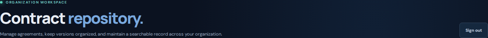

### 02 — Contract portfolio
A portfolio snapshot that gives legal and operations teams visibility into contract volume, execution status and document coverage.

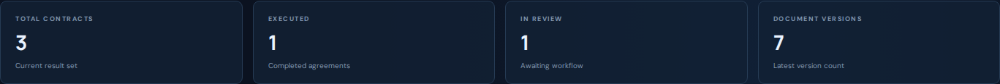

### 03 — Lifecycle performance
A commitment-focused view of open obligations, overdue items, notice deadlines and renewals in progress.

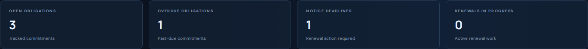

### 04 — Evidence-grounded contract review
The evidence-led intelligence workspace, showing deterministic review findings, severity, confidence and source excerpts. The showcase report is synthetic and demonstrates the interface, not a legal conclusion.

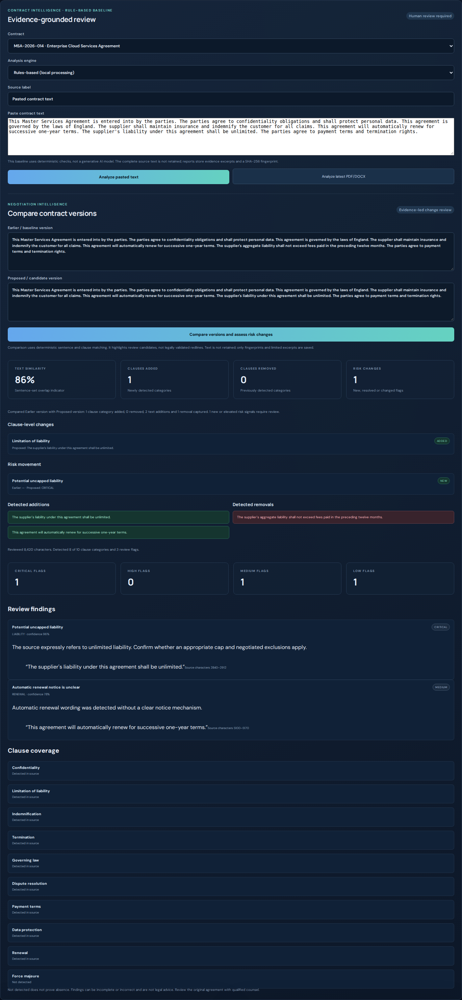

### 05 — Contract version comparison
A negotiation-review surface for clause changes, risk movement, additions and removals between an earlier and proposed agreement.

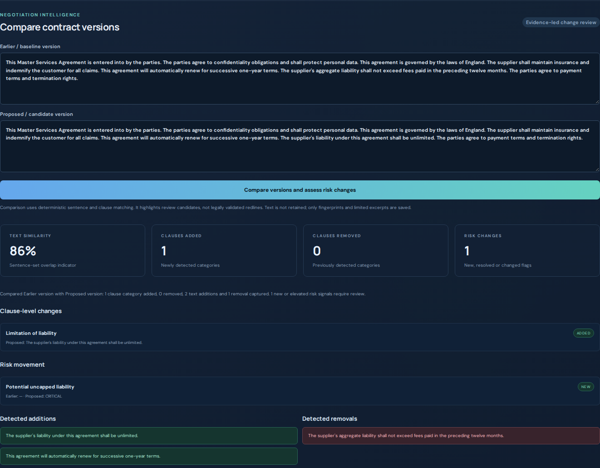

### 06 — Approval governance
Workflow configuration and the assigned reviewer queue bring decision ownership and multi-stage governance into the same operational view.

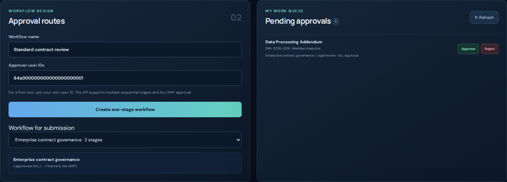

### 07 — Obligation management
A practical view of payment, compliance and delivery commitments, including ownership, due dates and action states.

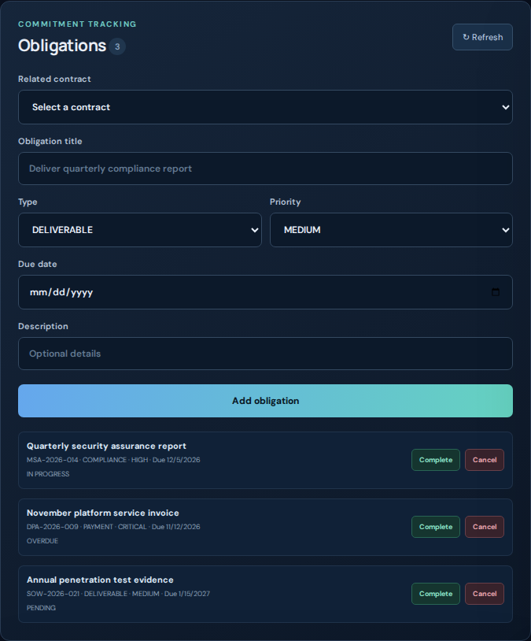

### 08 — Renewal calendar
Renewal expiry and notice deadlines are surfaced together so teams can plan renewal, renegotiation or termination decisions ahead of critical dates.

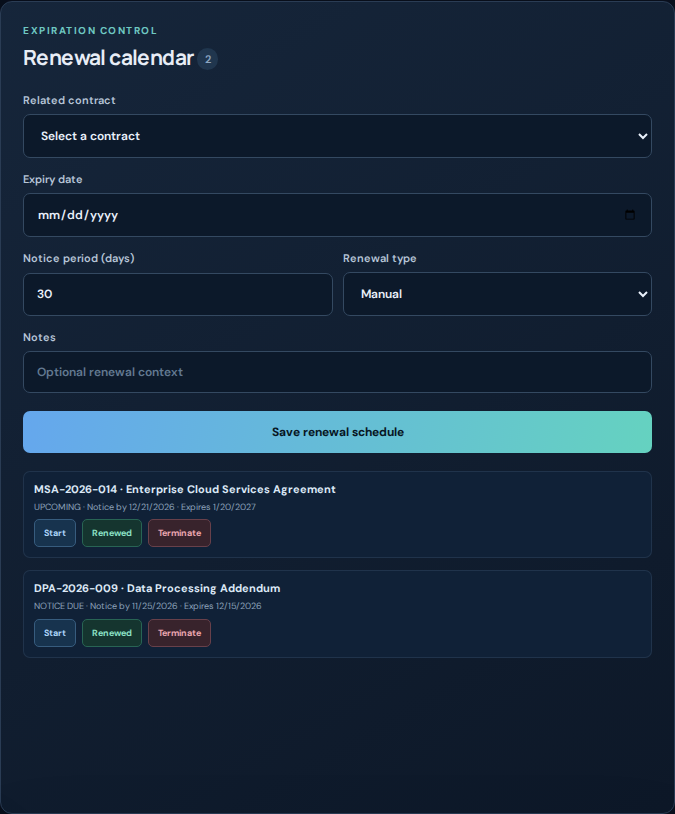

### 09 — Template and clause governance
Reusable legal language, version-pinned clauses, structured fields and independent template approval support consistent contract creation.

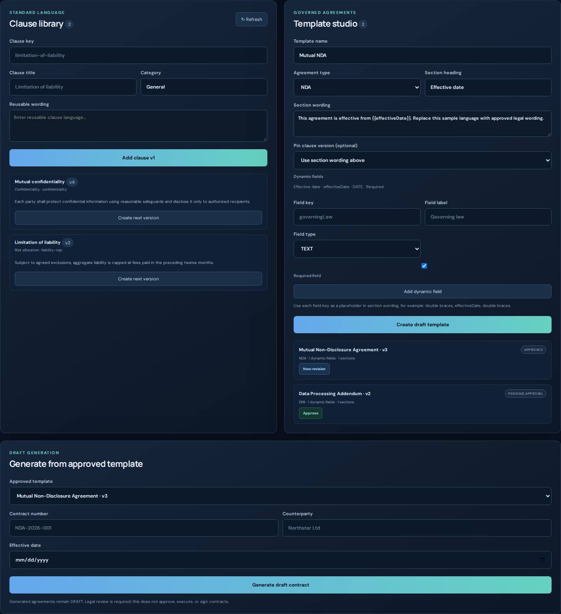

### 10 — Third-party risk
Vendor profiles and human-reviewed risk signals give procurement and legal teams a shared counterparty context.

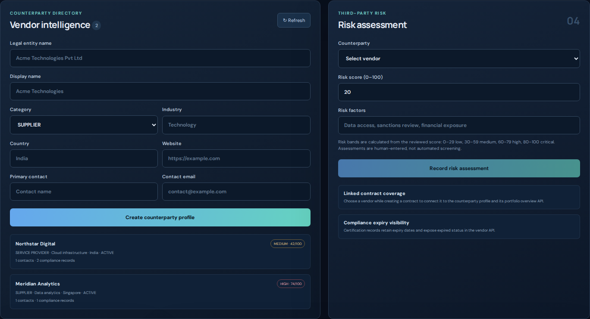

### 11 — Contract intake
A focused intake form captures key agreement metadata before a record enters the organization's controlled repository.

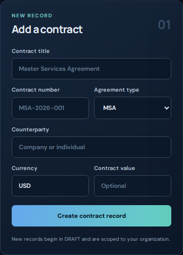

### 12 — Searchable agreement repository
The repository view brings agreement identity, counterparty, lifecycle status, version history and document actions together.

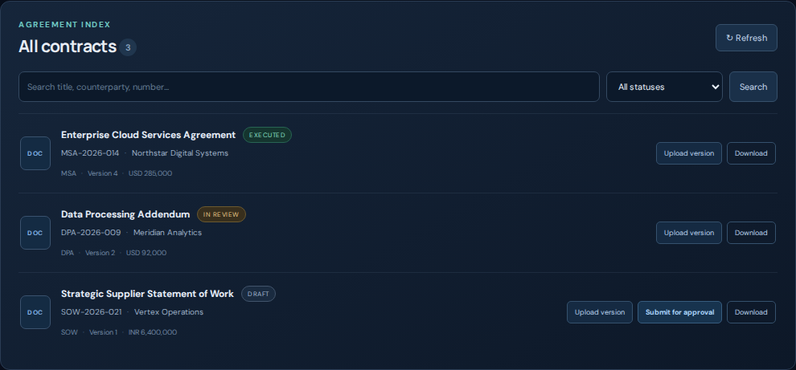

---

## 10. Project roadmap

- [x] Monorepo scaffold and Vue/Express application
- [x] Organization onboarding, authentication and role model
- [x] Tenant-scoped contract repository and document version metadata
- [x] Private S3-compatible upload/download workflow
- [x] Multi-stage approval workflow engine
- [x] Obligation and renewal tracking
- [x] Vendor/counterparty directory and human-reviewed risk assessments
- [x] Governed templates, dynamic fields and versioned clause library
- [x] Audit events and in-app notifications
- [x] Rules-based contract intelligence with source evidence
- [x] PDF/DOCX extraction and optional provider-backed analysis
- [x] Contract version comparison with clause and risk-change summaries
- [x] Playwright dashboard showcase capture for twelve screens
- [ ] OCR and page-level evidence provenance
- [ ] Semantic comparison and legally meaningful redline review
- [ ] Durable jobs, reminders and outbound notification delivery
- [ ] Malware scanning and deeper document validation
- [ ] Database-enforced audit immutability and enterprise retention controls
- [ ] End-to-end security, performance and disaster-recovery validation

---

## 11. Contributing and security reporting

Contributions should preserve tenant isolation, resource-level authorization, input validation, evidence provenance and human oversight for legal decisions. Add tests for new domain behavior and update this README when API contracts or operational requirements change.

Do not open public issues containing credentials, personal data, confidential contracts or exploitable vulnerability details. Report security concerns privately to the repository maintainer.

## 12. License

A license has not yet been selected. Until a license is added, all rights are reserved; do not assume the repository grants permission to redistribute or use the software.
